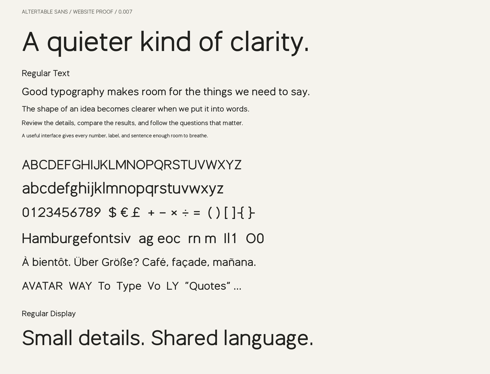

# Altertable Sans

An open-source sans-serif typeface for interfaces and the web, with broad
proportions, open counters, and tabular numerals. Available in six Text weights
with matching italics, plus a Regular Display style.

**Version 0.006 · Experimental · SIL Open Font License 1.1**

The family is in active development. You can use and modify it, but expect changes
to letterforms, spacing, and metrics before a stable release.



## Get the fonts

The [fonts directory](fonts/) contains ready-to-use files:

- **TTF** for desktop applications. Download the styles you need and install them
  through your operating system's font manager.
- **WOFF2** for self-hosted websites.

To download the whole project, use GitHub's **Code → Download ZIP**, or clone it:

```sh
git clone https://github.com/altertable-ai/altertable-sans.git
cd altertable-sans
```

No build step is required to use the included fonts.

## Styles

| Family | Style | Weight | Upright | Italic |
| --- | --- | --- | --- | --- |
| Text | Light | 300 | ✓ | ✓ |
| Text | Regular | 400 | ✓ | ✓ |
| Text | Book | 450 | ✓ | ✓ |
| Text | Medium | 500 | ✓ | ✓ |
| Text | Semibold | 600 | ✓ | ✓ |
| Text | Bold | 700 | ✓ | ✓ |
| Display | Regular | 400 | ✓ | — |

Text has more spacing and slightly stronger strokes than Display. Italics use a
10° inclination with distinct single-storey `a` and `g` forms. All styles are
static fonts; there is no variable font yet.

## Use on the web

Copy [altertable-sans.css](altertable-sans.css), the `fonts/` directory, and
[OFL.txt](OFL.txt) into the same directory on your site. Load the stylesheet:

```html
<link rel="stylesheet" href="/fonts/altertable-sans/altertable-sans.css" />
```

```css
body {
  font-family: 'Altertable Sans', system-ui, sans-serif;
  font-weight: 400;
}

h1, h2 {
  font-weight: 500;
}

em {
  font-style: italic;
}
```

The stylesheet declares all twelve Text faces. Browsers fetch only the faces
needed by the page. It uses `font-display: optional`, so a slow first load may
retain the fallback font. You can change that policy to suit your site.

Display is supplied separately as `AltertableSansDisplay-Regular.woff2`; add an
`@font-face` declaration under a separate family name if you want to use it.
Keep a fallback stack for characters outside the font's coverage.

## Character coverage

Each style supports **267 Unicode characters**: printable ASCII, selected
precomposed Latin accents, punctuation, currencies, arrows, mathematical symbols,
and spacing characters. Numerals are tabular by default. Kerning includes
accented variants of the supported letter pairs.

See [coverage.json](fonts/coverage.json) for the exact character set in each style.
This is partial Latin coverage, not a claim of complete language support.
Combining marks and decomposed accented text are not yet supported; use
precomposed characters where available.

## Preview

Serve the checkout locally:

```sh
python3 -m http.server 8768
```

Open <http://localhost:8768/specimen.html> for editable text, reading-size samples,
all weights, and italics. The [static specimen](proof.png) is also included.

## Build from source

Use Python 3.12 with a virtual environment:

```sh
python3.12 -m venv .venv
source .venv/bin/activate
python -m pip install -r requirements.txt
python build.py
python verify.py
python proof.py
```

On Windows, activate the environment with `.venv\Scripts\Activate.ps1` in
PowerShell instead of `source`.

The build writes TTF and WOFF2 files plus the coverage manifest into `fonts/`.
Verification checks character coverage, font metadata, metrics, contours,
clipping, kerning, and byte-identical rebuilds. GitHub Actions runs the build,
verification, and proof renderer on each push and pull request.

Editable drawings live in [sources/](sources/): `glyphs.py` defines the base
letterforms, `italics.py` the italic alternates, `spacing.py` sidebearings and
kerning, and `symbols.py` additional symbols. The builder expands these
centerlines into flattened outlines. This is an experimental construction
method, not a finished set of Bézier masters.

## Contributing

[Issues](https://github.com/altertable-ai/altertable-sans/issues) and pull requests
are welcome. Useful reports include the text being rendered, style and weight,
font size, operating system, application or browser, and a screenshot.

For drawing or spacing changes, edit the sources, rebuild the fonts, run
`verify.py`, and include before-and-after specimens at both text and display
sizes. Include regenerated font files and the coverage manifest with your change.

Current priorities are optical refinement, broader Latin coverage, combining-mark
positioning, improved curve outlines, hinting, and cross-platform rendering.
The weights and italics still need individual refinement; passing the automated
checks does not establish production readiness.

## Design notes

Altertable Sans began as an exploration of broad grotesk proportions inspired
by Anthropic Sans. Its source drawings are original; no third-party font
outlines or metrics are imported into the build. This project is not affiliated
with Anthropic or BSPK, and no proprietary reference font is distributed.

## License

Fonts and project sources are licensed under the
[SIL Open Font License 1.1](OFL.txt). There are no Reserved Font Names.
Keep the copyright notice and license with redistributed font files; see the
license for the full terms.

Copyright 2026 The Altertable Sans Project Authors.
