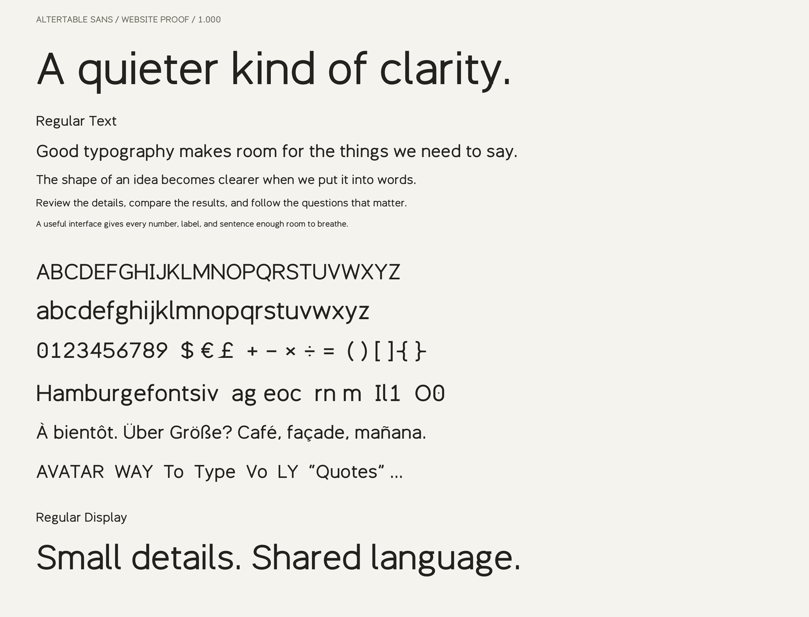

# Altertable Sans

An open-source sans-serif typeface for interfaces and the web, with broad
proportions, open counters, and tabular numerals. Available in five Text weights
with matching italics, plus a Regular Display style.

**Version 1.000 · Experimental · SIL Open Font License 1.1**

The family is in active development. You can use and modify it, but expect changes
to letterforms, spacing, and metrics before a stable release.



## Google Fonts engineering update

Version 1.000 adds the missing Latin Core characters, Welsh and additional Latin
letters, fixes metadata and style linking, and exports editable UFO sources.
The version follows Google Fonts' numbering requirements; the design remains
experimental. Book (450) has been removed. Use Regular (400) or Medium (500)
instead. SemiBold filenames now use the canonical `SemiBold` spelling.

Heavy percent, at-sign, and section-sign counters are corrected. Combining
commas are more compact, and rounded contours are cleaned without changing
text advances. Typographic line metrics remain unchanged.

## Get the fonts

The [fonts directory](fonts/) contains ready-to-use files:

- **TTF** for desktop applications. Download the styles you need and install them
  through your operating system's font manager.
- **WOFF2** for self-hosted websites.

To download the whole project, use GitHub's **Code → Download ZIP**, or clone it:

```sh
git clone https://github.com/altertable-ai/altertable-sans.git
cd altertable-sans
```

No build step is required to use the included fonts.

## Styles

| Family | Style | Weight | Upright | Italic |
| --- | --- | --- | --- | --- |
| Text | Light | 300 | ✓ | ✓ |
| Text | Regular | 400 | ✓ | ✓ |
| Text | Medium | 500 | ✓ | ✓ |
| Text | SemiBold | 600 | ✓ | ✓ |
| Text | Bold | 700 | ✓ | ✓ |
| Display | Regular | 400 | ✓ | — |

Text has more spacing and slightly stronger strokes than Display. Capital I
has crossbars, lowercase l has an exit stroke, and zero has a dot. Heavy a/g
bowls have optical corrections, and heavy/italic f pairs have separate spacing. Italics use a
10° inclination with distinct single-storey `a` and `g` forms. All styles are
static fonts; there is no variable font yet.

## Use on the web

Copy [altertable-sans.css](altertable-sans.css), the `fonts/` directory, and
[OFL.txt](OFL.txt) into the same directory on your site. Load the stylesheet:

```html
<link rel="stylesheet" href="/fonts/altertable-sans/altertable-sans.css" />
```

```css
body {
  font-family: 'Altertable Sans', system-ui, sans-serif;
  font-weight: 400;
}

h1, h2 {
  font-weight: 500;
}

em {
  font-style: italic;
}
```

The stylesheet declares all ten Text faces. Browsers fetch only the faces
needed by the page. It uses `font-display: optional`, so a slow first load may
retain the fallback font. You can change that policy to suit your site.

Display is supplied separately as `AltertableSansDisplay-Regular.woff2`; add an
`@font-face` declaration under a separate family name if you want to use it.
Keep a fallback stack for characters outside the font's coverage.

### Numeral spacing

Figures are tabular by default: every digit has the same advance for aligned
columns. The tabular `1` has a short base to balance its otherwise narrow shape.
Use proportional figures for running text; they include a narrower footless `1`
and optically spaced digits, periods, and commas.

```css
.price-in-text { font-variant-numeric: proportional-nums; }
.numeric-column { font-variant-numeric: tabular-nums; }
```

These use the font's `pnum` and `tnum` OpenType features. Compare the 0.011 default
with both 0.012 options in [figure-spacing-proof.html](figure-spacing-proof.html).

## Character coverage

Each style supports **420 Unicode characters**: printable ASCII, all letters in
Latin-1 and Latin Extended-A, Romanian comma-below letters, capital sharp S,
punctuation, currencies, arrows, mathematical symbols,
and spacing characters. Numerals are tabular by default, with a dotted zero for identifiers. Kerning includes
accented variants of the supported letter pairs.

See [coverage.json](fonts/coverage.json) for the exact character set in each style.
Coverage is not a claim of complete language support (for example, Vietnamese
and non-Latin scripts still require fallback). Fourteen zero-width combining
marks are supported: grave, acute, circumflex, tilde, macron, breve, dot above,
diaeresis, ring above, double acute, caron, comma below, cedilla, and ogonek.
OpenType `ccmp`, `mark`, and `mkmk` handle canonical compositions, dot removal
on accented i/j, and mark attachment/stacking. Windows clipping bounds allow
for two stacked marks while typographic line metrics remain unchanged;
arbitrary stacks still need suitable layout space.

## Preview

Serve the checkout locally:

```sh
python3 -m http.server 8768
```

Open <http://localhost:8768/specimen.html> to explore the current font:

- Editable headlines and paragraphs at reading and display sizes.
- All Text weights and italics, plus Regular Display.
- Proportional figures in text and tabular figures in aligned columns.
- Character coverage, accents, and combining marks.
- Altertable brand examples on light and dark surfaces, including metrics and
  interface labels.

The [static specimen](proof.png) is also included. Proofs render
HarfBuzz-shaped glyphs through FreeType, including substitutions and mark
offsets; they are not a substitute for browser/platform testing.

## Build from source

Use Python 3.12 with a virtual environment:

```sh
python3.12 -m venv .venv
source .venv/bin/activate
python -m pip install -r requirements.txt
python build.py
python verify.py
python -m unittest discover -v
python proof.py
python proof_latin.py
python proof_readability.py
python proof_googlefonts.py
```

On Windows, activate the environment with `.venv\Scripts\Activate.ps1` in
PowerShell instead of `source`.

The build writes TTF and WOFF2 files plus the coverage manifest into `fonts/`.
Verification checks character coverage, font metadata, metrics, contours,
clipping, kerning, and byte-identical rebuilds. GitHub Actions runs the build,
verification, and proof renderers on each push and pull request. The CI matrix
also loads the WOFF2 fonts in Chromium, Firefox, and WebKit on Linux, macOS, and
Windows, checking all Text weights/italics, canonical shaping, tabular numbers,
mobile/desktop overflow, light/dark presentation, and download-failure fallback.
Screenshots and measured widths are uploaded as workflow artifacts.
A separate CI job compiles the checked-in UFOs with Fontmake and compares their
outlines, metrics, coverage, and shaping with the distribution.
The tested font distribution is also uploaded as the `font-distribution` artifact.

### Google Fonts readiness

After the build and test matrix passes, CI runs FontBakery's `googlefonts`
profile against the tested TTFs, separately for Text and Display. Download
`googlefonts-readiness-Text` and `googlefonts-readiness-Display` from the workflow
run for HTML and JSON reports. Findings are informational and do not block
GitHub Releases. Tool installation or missing-report failures remain visible
as CI failures. Reports are artifacts, not committed source files.

To reproduce the checks locally, use a separate Python 3.12 environment so QA
dependencies do not change the font build environment:

```sh
python3.12 -m venv /tmp/altertable-googlefonts-qa
/tmp/altertable-googlefonts-qa/bin/python -m pip install -r requirements-googlefonts.txt
mkdir -p /tmp/altertable-googlefonts-reports
for family in Text Display; do
  /tmp/altertable-googlefonts-qa/bin/fontbakery check-googlefonts \
    --no-progress --no-colors --timeout 30 \
    --html "/tmp/altertable-googlefonts-reports/$family.html" \
    --json "/tmp/altertable-googlefonts-reports/$family.json" \
    fonts/AltertableSans"$family"-*.ttf
done
```

FontBakery returns a nonzero status for failing checks. Review failures, warnings,
errors, and skipped checks; a passing report alone does not establish readiness.
The repaired fonts pass the profile without failing checks. Warnings still need
review: the project vendor ID `ATBL` is not registered with Microsoft; Google
Fonts subset definitions omit some supported marks and symbols; contour-count
and caron checks include design heuristics. Small near-axis segments and narrow
joins still receive outline-review warnings; these need type-design judgment,
not indiscriminate contour simplification. No checks are excluded to hide
these results. Metadata/catalog checks that need a `google/fonts` submission
directory are skipped in this upstream repository. Before submission, complete
the catalog metadata and designer attribution with the Google Fonts team, sign
the contributor agreement, and confirm the remaining design-review items.
Follow the [Google Fonts onboarding guide](https://googlefonts.github.io/gf-guide/onboarding.html)
and open an Add Font issue before proposing a PR to `google/fonts`. Submission
automation is deferred until the family is ready for review.

### Releases

Push a version tag matching the font metadata (for example, `v1.000`) to publish
a GitHub Release. The tag runs the same build and tests on all three operating
systems; publication only proceeds when the entire matrix passes. A mismatched
tag fails verification. The release includes a ZIP of the tested TTF/WOFF2 fonts,
coverage manifest, stylesheet, license, and README, plus `SHA256SUMS`.

After updating `VERSION` in `sources/font_metadata.py`, rebuilding the fonts, and committing
the release changes:

```sh
git tag -a v1.000 -m "Altertable Sans 1.000"
git push origin v1.000
```

Use the new version in place of `v1.000` for subsequent releases. Branch pushes,
pull requests, and manual workflow runs build and test without publishing.

Run the browser checks locally with:

```sh
npm ci
npx playwright install --with-deps chromium firefox webkit
npm run test:browser
```

[The interface proof](browser-proof.html) is a typography test fixture. It does
not replace an acceptance pass over every product screen. A local query-screen
Storybook pass is also used during this release's review.

### Editable sources

The Python drawings in `sources/` are the procedural design source. Running
`python build.py` regenerates both the distribution fonts and the UFOs in
`sources/ufo/`. UFOs contain editable outlines, character maps, metrics, naming,
and OpenType feature source. **Regeneration overwrites edits made directly to
those UFOs**, so keep any intentional UFO edits in version control.

To compile the checked-in UFOs without regenerating them, use a separate Python
3.12 environment and the standard Fontmake pipeline:

```sh
python3.12 -m venv /tmp/altertable-ufo-build
/tmp/altertable-ufo-build/bin/python -m pip install -r requirements-source.txt
/tmp/altertable-ufo-build/bin/python sources/build.py --output-dir /tmp/altertable-ufo-fonts
```

The generator expands original centerlines into flattened outlines. UFO export
makes those outlines editable in standard font editors; it does not convert
them into Bézier masters or a variable font.

## Contributing

[Issues](https://github.com/altertable-ai/altertable-sans/issues) and pull requests
are welcome. Useful reports include the text being rendered, style and weight,
font size, operating system, application or browser, and a screenshot.

For drawing or spacing changes, edit the sources, rebuild the fonts, run
`verify.py`, and include before-and-after specimens at both text and display
sizes. Include regenerated font files and the coverage manifest with your change.

Current priorities are optical refinement, broader Latin coverage, further
language-specific refinement, improved curve outlines, hinting, and cross-platform rendering.
The weights and italics still need individual refinement; passing the automated
checks does not establish production readiness.

## Design notes

Altertable Sans began as an exploration of broad grotesk proportions inspired
by Anthropic Sans. Its source drawings are original; no third-party font
outlines or metrics are imported into the build. This project is not affiliated
with Anthropic or BSPK, and no proprietary reference font is distributed.

## License

Fonts and project sources are licensed under the
[SIL Open Font License 1.1](OFL.txt). There are no Reserved Font Names.
Keep the copyright notice and license with redistributed font files; see the
license for the full terms.

Copyright 2026 The Altertable Sans Project Authors.
